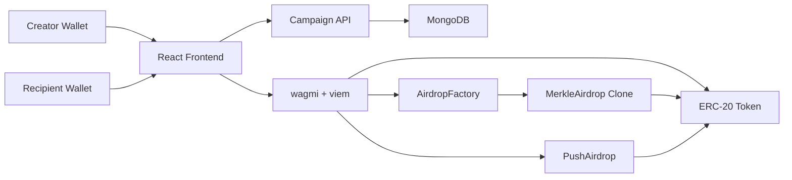

# Multidrop dApp

Multidrop is a full-stack token distribution dApp for creating ERC-20 airdrop campaigns. It supports both pull-based Merkle airdrops, where eligible recipients claim their allocation, and push-based multisend distributions, where a creator sends tokens directly to recipients in batches.

The project is split into a Foundry smart-contract workspace and a React/Vite frontend.

## Features

- Create pull-based ERC-20 airdrops with Merkle proofs.
- Deploy lightweight campaign contracts through an `AirdropFactory`.
- Claim eligible allocations from a funded `MerkleAirdrop` campaign.
- Refund unclaimed tokens to the campaign creator after the deadline.
- Send push-style token distributions through a batch multisend contract.
- Connect wallets with wagmi and viem.
- Persist complete campaign metadata through a MongoDB-backed API.
- Show an Airdrop or Multisend flag on each campaign in the distribution list.

## Project Structure

```text
Airdrop-Project/
  contracts/            Solidity contracts, Foundry config, tests, and scripts
  front-end/            React + Vite frontend
  PROJECT_DOCUMENTATION.md
  README.md
```

Important files:

- `contracts/src/MerkleAirdrop.sol` - pull-based claim contract.
- `contracts/src/AirdropFactory.sol` - deploys and funds Merkle airdrop clones.
- `contracts/src/PushAirdrop.sol` - push-based ERC-20 multisend helper.
- `contracts/src/TestToken.sol` - local testing ERC-20 token.
- `front-end/src/App.jsx` - frontend routes.
- `front-end/src/constants/contracts.js` - deployed contract addresses and ABIs.
- `front-end/src/wagmi.js` - wallet and chain configuration.

## Architecture



### Pull Airdrop

1. Creator enters a token address and recipient allocation list.
2. Frontend builds a Merkle tree from `(recipient, amount)` leaves.
3. Creator approves the factory for the total allocation.
4. `AirdropFactory` deploys a `MerkleAirdrop` clone and funds it.
5. Eligible recipients generate proofs from campaign metadata and call `claim`.
6. After the deadline, the creator can call `refund` for unclaimed tokens.

### Push Airdrop

1. Creator enters a token address and recipient allocation list.
2. Frontend batches recipients in groups of up to 10.
3. Creator approves the `PushAirdrop` contract.
4. `PushAirdrop` transfers tokens directly to recipients.

## Tech Stack

### Smart Contracts

- Solidity `^0.8.20`
- Foundry
- OpenZeppelin Contracts
- EIP-1167 minimal proxy clones

### Frontend

- React 19
- Vite
- wagmi
- viem
- merkletreejs
- React Router
- Tailwind CSS
- lucide-react

## Prerequisites

Install the following before running the project locally:

- [Node.js](https://nodejs.org/)
- npm
- [Foundry](https://book.getfoundry.sh/getting-started/installation)
- A browser wallet such as MetaMask

## Local Development

### 1. Clone the repository

```shell
git clone <your-repository-url>
cd Airdrop-Project
```

### 2. Install dependencies

```shell
cd front-end
npm install
```

```git-bash/zsh
cd contracts
forge install
```

### 3. Build and test contracts

From the `contracts/` directory:

```git-bash
forge build
forge test
```

### 4. Start a local chain

In a separate terminal:

```shell
cd contracts
anvil
```

### 5. Deploy local contracts

The deployment script reads these environment variables:

- `deployerPrivateKey`
- `creatorPrivateKey`

From the `contracts/` directory:

```shell
forge script script/Deploy.s.sol:Deploy --rpc-url http://127.0.0.1:8545 --broadcast
```

After deployment, copy the deployed `AirdropFactory`, `PushAirdrop`, and
`TestToken` addresses into:

```text
front-end/.env
```

### 6. Start the frontend

From the `front-end/` directory:

```shell
npm run dev
```

Open the Vite URL in your browser and connect a wallet on the Anvil network.

### 7. Start the campaign API

Create `front-end/.env` from `front-end/.env.example`, then set `MONGODB_URI` to your local or Atlas connection string.

Run the API in a separate terminal from `front-end/`:

```shell
npm run api
```

When the API starts, it creates the `multidrop.campaigns` collection if it does not exist yet. When the frontend starts, it reads campaigns from MongoDB through this API. New campaigns and status updates are saved back to MongoDB.

### 8. Use the VS Code MongoDB extension

The VS Code MongoDB extension helps you inspect the database, but it does not replace the API server.

1. Open the MongoDB extension in VS Code.
2. Add a connection using the same value as `MONGODB_URI`, for example `mongodb://127.0.0.1:27017`.
3. After connecting, open the `multidrop` database.
4. Open the `campaigns` collection.
5. Run `npm run api`, then refresh the MongoDB extension. The `campaigns` collection should exist even before a campaign is created.
6. Create a campaign in the app, then refresh the collection in VS Code to see the saved document.

To manually add sample campaigns, use the documents in:

```text
front-end/server/seed/dummyCampaigns.json
```

You can insert them into `multidrop.campaigns` with the MongoDB extension import/insert-many flow. After inserting, refresh the app or open `/airdrops`; the campaigns should appear without connecting a wallet.

If the extension cannot connect, MongoDB itself is probably not running locally, or your Atlas connection string is wrong. If the extension connects but the app does not save, check that `npm run api` is running and that `front-end/.env` has the same `MONGODB_URI`.

## Frontend Scripts

Run these from `front-end/`:

```shell
npm run dev
npm run api
npm run build
npm run lint
npm run preview
```

## Online Deployment

Production uses Vercel for the Vite frontend, a hosted Node web service for the Express campaign API, MongoDB Atlas for persistence, and deployed contracts on Polygon Amoy or mainnet. You do not run `anvil` or `vite dev` in production.

### 1. Deploy the API

Deploy the Express API from `front-end/` on Render or Railway.

```text
Build Command: npm ci
Start Command: npm run api
Health Check Path: /api/health
```

The repository includes `render.yaml` for a Render Blueprint. Set these service environment variables:

```text
MONGODB_URI=mongodb+srv://...
MONGODB_DB_NAME=multidrop
MONGODB_CAMPAIGNS_COLLECTION=campaigns
CORS_ORIGIN=https://<your-vercel-domain>
```

Use the MongoDB Atlas connection string for `MONGODB_URI`, and allow the hosted API service to access the Atlas cluster in Atlas Network Access.

### 2. Configure Vercel

Deploy `front-end/` to Vercel with:

```text
Framework Preset: Vite
Root Directory: front-end
Install Command: npm ci
Build Command: npm run build
Output Directory: dist
```

Before deploying, replace the placeholder API host in `front-end/vercel.json`:

```text
https://your-multidrop-api.example.com
```

Set this Vercel environment variable so frontend API requests stay same-origin through the Vercel rewrite:

```text
VITE_CAMPAIGNS_API_URL=/api/campaigns
```

### 3. Deploy contracts

Deploy to Polygon Amoy first:

```shell
cd contracts
forge script script/Deploy.s.sol:Deploy --rpc-url $AMOY_RPC_URL --broadcast
```

Then set these Vercel environment variables from the deployment logs:

```text
VITE_FACTORY_ADDRESS=<deployed AirdropFactory address>
VITE_PUSH_AIRDROP_ADDRESS=<deployed PushAirdrop address>
VITE_AMOY_RPC_URL=https://rpc-amoy.polygon.technology
VITE_ENABLE_ANVIL=false
```

## Contract Commands

Run these from `contracts/`:

```shell
forge build
forge test
forge fmt
anvil
```

## Configuration Notes

The frontend defaults to local development contract addresses when deployment env vars are not set:

```js
VITE_FACTORY_ADDRESS=0xe7f1725E7734CE288F8367e1Bb143E90bb3F0512
VITE_PUSH_AIRDROP_ADDRESS=0x9fE46736679d2D9a65F0992F2272dE9f3c7fa6e0
VITE_TEST_TOKEN_ADDRESS=0x8464135c8F25Da09e49BC8782676a84730C318bC
```

These are Anvil-style addresses for the default local deploy. The factory and
push addresses are distribution/spender contracts; use the test token address in
the app's token field. Set `VITE_FACTORY_ADDRESS` and
`VITE_PUSH_AIRDROP_ADDRESS` in Vercel after any Polygon Amoy/mainnet deployment.

The wagmi config reads public network RPC URLs from Vite env vars:

```text
VITE_ANVIL_RPC_URL=http://127.0.0.1:8545
VITE_AMOY_RPC_URL=https://rpc-amoy.polygon.technology
VITE_MAINNET_RPC_URL=<provider mainnet RPC URL>
VITE_ENABLE_ANVIL=false
```

Campaign metadata is stored by the API in MongoDB using these frontend `.env` values:

```text
MONGODB_URI=mongodb://127.0.0.1:27017
MONGODB_DB_NAME=multidrop
MONGODB_CAMPAIGNS_COLLECTION=campaigns
API_PORT=5050
HOST=0.0.0.0
CORS_ORIGIN=http://localhost:5173
VITE_API_PROXY_TARGET=http://localhost:5050
VITE_CAMPAIGNS_API_URL=/api/campaigns
VITE_TEST_TOKEN_ADDRESS=0x8464135c8F25Da09e49BC8782676a84730C318bC
```

Storage behavior:

- MongoDB is the only source of truth for campaign data.
- Browser `sessionStorage` and `localStorage` are not used for campaign persistence.
- If the API is offline, campaigns cannot be loaded or saved permanently.
- In production, Vercel rewrites `/api/*` to the hosted Express API.

## Airdrop List Format

Merkle generation scripts expect `contracts/airdrop_list.json` to use this structure:

```json
{
  "airdrops": [
    {
      "address": "0x0000000000000000000000000000000000000000",
      "amount": "1000000000000000000"
    }
  ]
}
```

Amounts should be token base units, for example `1000000000000000000` for `1` token with 18 decimals.

## Known Limitations

- Campaign metadata requires the MongoDB API for loading and saving.
- Claiming from the frontend requires the original recipient list to reconstruct proofs.
- Mainnet and Polygon Amoy RPC values must be configured through Vite env vars before production use.
- `PushAirdrop` limits each transaction to 10 recipients for testing-oriented batching.
- The frontend build may warn about bundle size.
- The frontend currently has lint issues documented in `PROJECT_DOCUMENTATION.md`.

For production use, consider adding a persistent campaign registry, IPFS or Arweave proof storage, proper RPC configuration, and expanded contract validation.

## Documentation

See `PROJECT_DOCUMENTATION.md` for a deeper technical walkthrough, verification notes, current risks, and suggested next steps.

## License

This project uses MIT-licensed Solidity contracts. Add a repository-level `LICENSE` file before publishing if you want GitHub to detect the license automatically.
