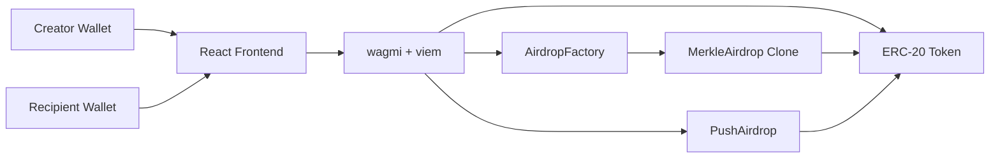

# Multidrop Airdrop dApp

Multidrop is a full-stack token distribution dApp for creating ERC-20 airdrop campaigns. It supports both pull-based Merkle airdrops, where eligible recipients claim their allocation, and push-based multisend distributions, where a creator sends tokens directly to recipients in batches.

The project is split into a Foundry smart-contract workspace and a React/Vite frontend.

## Features

- Create pull-based ERC-20 airdrops with Merkle proofs.
- Deploy lightweight campaign contracts through an `AirdropFactory`.
- Claim eligible allocations from a funded `MerkleAirdrop` campaign.
- Refund unclaimed tokens to the campaign creator after the deadline.
- Send push-style token distributions through a batch multisend contract.
- Connect wallets with wagmi and viem.
- Store local campaign metadata in the browser for development workflows.

## Project Structure

```text
Airdrop-Project/
  contracts/            Solidity contracts, Foundry config, tests, and scripts
  front-end/            React + Vite frontend
  PROJECT_DOCUMENTATION.md
  README.md
```

Important files:

- `contracts/src/MerkleAirdrop.sol` - pull-based claim contract.
- `contracts/src/AirdropFactory.sol` - deploys and funds Merkle airdrop clones.
- `contracts/src/PushAirdrop.sol` - push-based ERC-20 multisend helper.
- `contracts/src/TestToken.sol` - local testing ERC-20 token.
- `front-end/src/App.jsx` - frontend routes.
- `front-end/src/constants/contracts.js` - deployed contract addresses and ABIs.
- `front-end/src/wagmi.js` - wallet and chain configuration.

## Architecture



### Pull Airdrop

1. Creator enters a token address and recipient allocation list.
2. Frontend builds a Merkle tree from `(recipient, amount)` leaves.
3. Creator approves the factory for the total allocation.
4. `AirdropFactory` deploys a `MerkleAirdrop` clone and funds it.
5. Eligible recipients generate proofs from campaign metadata and call `claim`.
6. After the deadline, the creator can call `refund` for unclaimed tokens.

### Push Airdrop

1. Creator enters a token address and recipient allocation list.
2. Frontend batches recipients in groups of up to 10.
3. Creator approves the `PushAirdrop` contract.
4. `PushAirdrop` transfers tokens directly to recipients.

## Tech Stack

### Smart Contracts

- Solidity `^0.8.20`
- Foundry
- OpenZeppelin Contracts
- EIP-1167 minimal proxy clones

### Frontend

- React 19
- Vite
- wagmi
- viem
- merkletreejs
- React Router
- Tailwind CSS
- lucide-react

## Prerequisites

Install the following before running the project locally:

- [Node.js](https://nodejs.org/)
- npm
- [Foundry](https://book.getfoundry.sh/getting-started/installation)
- A browser wallet such as MetaMask

## Local Development

### 1. Clone the repository

```shell
git clone <your-repository-url>
cd Airdrop-Project
```

### 2. Install dependencies

```shell
cd front-end
npm install
```

```git-bash/zsh
cd contracts
forge install

### 3. Build and test contracts

From the `contracts/` directory:

```git-bash
forge build
forge test
```

### 4. Start a local chain

In a separate terminal:

```shell
cd contracts
anvil
```

### 5. Deploy local contracts

The deployment script reads these environment variables:

- `deployerPrivateKey`
- `creatorPrivateKey`

From the `contracts/` directory:

```shell
forge script script/Deploy.s.sol:Deploy --rpc-url http://127.0.0.1:8545 --broadcast
```

After deployment, copy the deployed `AirdropFactory` and `PushAirdrop` addresses into:

```text
front-end/src/constants/contracts.js
```

### 6. Start the frontend

From the `front-end/` directory:

```shell
npm run dev
```

Open the Vite URL in your browser and connect a wallet on the Anvil network.

## Frontend Scripts

Run these from `front-end/`:

```shell
npm run dev
npm run build
npm run lint
npm run preview
```

## Contract Commands

Run these from `contracts/`:

```shell
forge build
forge test
forge fmt
anvil
```

## Configuration Notes

The frontend currently includes local development contract addresses:

```js
export const FACTORY_ADDRESS = '0xe7f1725E7734CE288F8367e1Bb143E90bb3F0512';
export const PUSH_AIRDROP_ADDRESS = '0x9fE46736679d2D9a65F0992F2272dE9f3c7fa6e0';
```

These are Anvil-style addresses and should be updated after a fresh local deployment or any testnet/mainnet deployment.

The wagmi config includes placeholder RPC URLs for mainnet and Sepolia. Replace them with real provider URLs before using public networks.

## Airdrop List Format

Merkle generation scripts expect `contracts/airdrop_list.json` to use this structure:

```json
{
  "airdrops": [
    {
      "address": "0x0000000000000000000000000000000000000000",
      "amount": "1000000000000000000"
    }
  ]
}
```

Amounts should be token base units, for example `1000000000000000000` for `1` token with 18 decimals.

## Known Limitations

- Campaign metadata is currently stored in browser `localStorage`.
- Claiming from the frontend requires the original recipient list to reconstruct proofs.
- Mainnet and Sepolia RPC values are placeholders.
- `PushAirdrop` limits each transaction to 10 recipients for testing-oriented batching.
- The frontend build may warn about bundle size.
- The frontend currently has lint issues documented in `PROJECT_DOCUMENTATION.md`.

For production use, consider adding a persistent campaign registry, IPFS or Arweave proof storage, proper RPC configuration, and expanded contract validation.

## Documentation

See `PROJECT_DOCUMENTATION.md` for a deeper technical walkthrough, verification notes, current risks, and suggested next steps.

## License

This project uses MIT-licensed Solidity contracts. Add a repository-level `LICENSE` file before publishing if you want GitHub to detect the license automatically.
