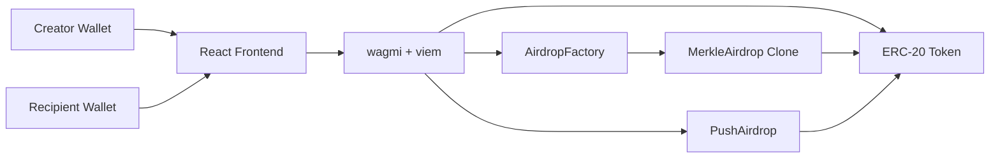

# Multidrop Project Documentation

Generated: 2026-06-24
Updated: 2026-07-06

## 1. Project Overview

Multidrop is a token distribution dApp for creating and claiming ERC-20 airdrops. The project contains:

- A smart contract system built with Foundry.
- A React/Vite frontend built with wagmi and viem.
- Two distribution models:
  - Pull airdrop: recipients claim their allocation from a Merkle-proof campaign contract.
  - Push multisend: the campaign creator sends tokens directly to recipients in batches.

The project is organized into two main workspaces:

```text
Airdrop-Project/
  contracts/   Solidity contracts, Foundry config, tests, and deployment scripts
  front-end/   React app, campaign API server, wagmi config, routes, and UI components
```

## 2. High-Level Architecture



The frontend prepares token distribution data, computes Merkle roots for pull campaigns, requests ERC-20 allowances, and submits transactions to the deployed contracts. Campaign metadata is stored through the MongoDB-backed campaign API, while the authoritative token custody and claim logic live on-chain.

## 3. Smart Contracts

### 3.1 `MerkleAirdrop.sol`

Purpose: Pull-based claim contract for one airdrop campaign.

Key state:

- `token`: ERC-20 token being distributed.
- `merkleRoot`: root generated from `(recipientAddress, amount)` leaves.
- `creator`: campaign owner.
- `deadline`: claim expiration timestamp.
- `hasClaimed`: prevents duplicate claims per wallet.

Main functions:

- `initialize(address _token, bytes32 _merkleRoot, address _creator, uint256 _deadline)`
  - Initializes clone state.
  - Protected by OpenZeppelin `initializer`.
- `claim(uint256 amount, bytes32[] calldata proof)`
  - Rejects expired campaigns.
  - Rejects duplicate claims.
  - Rebuilds leaf with `keccak256(abi.encodePacked(msg.sender, amount))`.
  - Verifies proof against `merkleRoot`.
  - Transfers tokens to the claimant.
- `refund()`
  - Only callable by `creator`.
  - Only callable after `deadline`.
  - Transfers remaining campaign balance back to the creator.

Important events:

- `Claimed(address claimant, uint256 amount)`
- `Refunded(address creator, uint256 amount)`

### 3.2 `AirdropFactory.sol`

Purpose: Deploys and funds pull-based Merkle airdrop campaigns using EIP-1167 minimal proxy clones.

Key state:

- `implementation`: immutable `MerkleAirdrop` implementation address.
- `allAirdrops`: array of deployed clone addresses.

Main function:

- `createAndFundAirdrop(address token, bytes32 merkleRoot, uint256 totalAllocation, uint256 durationInSeconds)`
  - Clones the `MerkleAirdrop` implementation.
  - Computes `deadline = block.timestamp + durationInSeconds`.
  - Initializes the clone.
  - Pulls `totalAllocation` tokens from the creator into the clone.
  - Stores the clone address in `allAirdrops`.
  - Emits `AirdropCreated`.

### 3.3 `PushAirdrop.sol`

Purpose: Push-based direct token distribution helper.

Main function:

- `pushTokens(address token, address[] calldata recipients, uint256[] calldata amounts, uint256 totalRequired)`
  - Supports up to 10 recipients per call.
  - Pulls `totalRequired` tokens from the creator.
  - Transfers each recipient their corresponding amount.
  - Verifies the processed sum matches `totalRequired`.

This model is useful when the creator wants recipients to receive tokens directly without requiring recipients to claim.

### 3.4 `TestToken.sol`

Purpose: Simple ERC-20 token for local testing.

Behavior:

- Mints `10000 ether` worth of tokens to the deployer.
- Constructor accepts token `name` and `symbol`.

## 4. Contract Scripts

### `Deploy.s.sol`

Deploys:

- `MerkleAirdrop` implementation.
- `AirdropFactory`.
- `PushAirdrop`.
- One sample `TestToken`.

Requires environment variables:

- `deployerPrivateKey`
- `creatorPrivateKey`

### `DeployAirdrop.s.sol`

Deploys pull-airdrop infrastructure, generates a Merkle root from `airdrop_list.json`, deploys a sample token, approves the factory, and creates a funded airdrop clone.

### `GenerateMerkle.s.sol`

Reads `airdrop_list.json`, builds a Merkle tree in Solidity, prints the Merkle root, and prints proof arrays for each user.

Expected JSON shape:

```json
{
  "airdrops": [
    {
      "address": "0x...",
      "amount": "1000000000000000000"
    }
  ]
}
```

### `Claim.s.sol`

Uses `GenerateMerkle` to fetch a proof for a configured claimant and submits a claim to a configured `MerkleAirdrop` contract.

## 5. Frontend

The frontend is a React 19 + Vite app using:

- `wagmi` for wallet/account hooks and contract reads/writes.
- `viem` for ABI parsing, address validation, unit parsing, event decoding, and hashing.
- `merkletreejs` for frontend Merkle root/proof generation.
- `react-router` for routing.
- Tailwind CSS via `@tailwindcss/vite`.
- `lucide-react` for UI icons.

### 5.1 Routes

Defined in `front-end/src/routes/AppRoutes.jsx`:

- `/`: Create a new distribution.
- `/airdrops`: View MongoDB-backed campaigns.
- `/airdrops/:id`: View campaign details and creator refund controls.
- `/claim`: Verify eligibility and claim from a pull campaign.
- `/guide`: Read role-based guidance for creators and recipients.

### 5.2 App State

Defined in `front-end/src/context/AppContext.jsx`.

The app context provides:

- Connected wallet address, network, and balance.
- Wallet connect/disconnect helpers.
- Airdrop campaign list.
- Campaign status update helper.
- Claim completion helper.
- Campaign storage status.
- Wallet modal state.

Campaign metadata is hydrated from and persisted to the campaign API at `/api/campaigns`, implemented in `front-end/server/`. The API stores campaign documents in MongoDB.

Important limitation: this MongoDB registry is still an application-managed campaign index, not a decentralized index. Pull claim proofs require the original recipient list stored with campaign metadata.

### 5.3 Contract Constants

Defined in `front-end/src/constants/contracts.js`.

Current local addresses:

- `FACTORY_ADDRESS = 0xe7f1725E7734CE288F8367e1Bb143E90bb3F0512`
- `PUSH_AIRDROP_ADDRESS = 0x9fE46736679d2D9a65F0992F2272dE9f3c7fa6e0`

These appear to be Anvil/local development addresses and should be updated after each fresh deployment or when moving to a testnet.

### 5.4 Wallet and Network Config

Defined in `front-end/src/wagmi.js`.

Configured chains:

- Anvil
- Ethereum mainnet
- Sepolia

Configured transports:

- Anvil: `http://127.0.0.1:8545`
- Mainnet: `https://alchemy.com`
- Sepolia: `https://sepolia.org`

The mainnet and Sepolia URLs are placeholders, not production RPC endpoints. They should be replaced with real provider URLs before testnet or production use.

## 6. User Flows

### 6.1 Pull Airdrop Creation

1. Creator connects wallet.
2. Creator enters ERC-20 token address.
3. Frontend reads token metadata: name, symbol, decimals, balance, allowance.
4. Creator enters or uploads recipients in `address, amount` format.
5. Frontend validates addresses and amounts.
6. Frontend computes total required token amount.
7. Frontend creates Merkle leaves using:

```text
keccak256(encodePacked(address, uint256))
```

8. Frontend builds a sorted-pair Merkle tree and computes the root.
9. Creator approves the factory to spend the total allocation.
10. Creator calls `createAndFundAirdrop`.
11. Factory deploys a `MerkleAirdrop` clone, initializes it, and transfers funds into the clone.
12. Frontend stores campaign metadata through the MongoDB-backed campaign API.

### 6.2 Pull Airdrop Claiming

1. Recipient connects wallet.
2. Recipient enters or follows a URL containing the campaign clone address.
3. Frontend looks up campaign metadata from the MongoDB-backed campaign state.
4. Frontend verifies the wallet appears in the stored recipient list.
5. Frontend checks whether the wallet already claimed.
6. Frontend reconstructs the Merkle tree and proof.
7. Recipient calls `claim(amount, proof)`.
8. Contract verifies the proof and transfers tokens.

### 6.3 Pull Airdrop Refund

1. Creator opens campaign details.
2. Frontend reads `creator` and `deadline` from the clone.
3. If the connected wallet is the creator and the deadline has passed, the refund button is enabled.
4. Creator calls `refund()`.
5. Contract transfers remaining campaign tokens back to the creator.

### 6.4 Push Multisend

1. Creator connects wallet.
2. Creator enters token and recipients.
3. Frontend validates data and splits recipients into batches of up to 10.
4. Creator approves the `PushAirdrop` contract.
5. Creator executes each batch transaction.
6. `PushAirdrop` pulls each batch total and transfers tokens directly to recipients.
7. Frontend marks the campaign complete through app state, which syncs to MongoDB.

### 6.5 In-App Guide

1. User opens `/guide` from the navbar.
2. User chooses the `Creator` or `Recipient` tab.
3. The guide explains the matching workflow and common claim result states.
4. User can jump to `/`, `/airdrops`, or `/claim` from guide links.

## 7. Local Development

### 7.1 Contracts

From `contracts/`:

```shell
forge build
forge test
```

Run a local chain:

```shell
anvil
```

Deploy locally:

```shell
forge script script/Deploy.s.sol:Deploy --rpc-url http://127.0.0.1:8545 --broadcast
```

Environment variables are required for scripts that read private keys.

### 7.2 Frontend

From `front-end/`:

```shell
npm install
npm run dev
npm run build
npm run lint
```

The frontend expects deployed contract addresses in:

```text
front-end/src/constants/contracts.js
```

Update those constants after deploying the contracts.

## 8. Verification Status

Commands attempted on 2026-06-24:

### Frontend build

Command:

```shell
npm run build
```

Result:

- Passed when run outside the restricted sandbox.
- Produced a chunk-size warning: main JS bundle is about `651.41 kB` minified.

### Frontend lint

Command:

```shell
npm run lint
```

Result:

- Failed with 29 errors and 7 warnings.

Main categories:

- Unused `React` imports.
- Unused variables such as `balanceData`, `txError`, and `isLoadingHasClaimed`.
- Hook-order violations in `AirdropDetails.jsx` caused by hooks being called after an early return.
- React compiler lint errors for synchronous state updates inside effects.
- Missing effect dependencies.
- One empty catch block in `CreateAirdrop.jsx`.

### Contract tests

Command:

```shell
forge test
```

Result:

- Not run in this environment because `forge` is not installed or not on PATH.

## 9. Current Risks and Improvement Areas

### 9.1 Factory input validation

`AirdropFactory.createAndFundAirdrop` does not explicitly validate:

- `token != address(0)`
- `merkleRoot != bytes32(0)`
- `totalAllocation > 0`
- `durationInSeconds > 0`

The test file expects some invalid inputs to revert, but the contract does not currently define explicit custom errors or require statements for all of those cases.

### 9.2 Application-managed campaign registry

The claim flow depends on campaign metadata saved in MongoDB through the app API. The contract can verify claims on-chain, but the frontend needs the original recipient list to reconstruct proofs.

For production, add one of:

- IPFS/Arweave-hosted distribution files.
- Event-indexed subgraph or indexer.
- Downloadable proof files for recipients.

### 9.3 RPC configuration

Mainnet and Sepolia RPC URLs in `wagmi.js` are placeholders. Use real RPC endpoints before deploying beyond local Anvil.

### 9.4 Push mode recipient limit

`PushAirdrop` supports only 10 recipients per call. The frontend batches recipients accordingly, but this is a testing-oriented limit and should be reviewed for production gas/UX needs.

### 9.5 Frontend lint debt

The frontend builds successfully, but lint currently fails. The hook-order issues are the most important because they can cause runtime instability.

### 9.6 Bundle size

The production build warns that one chunk exceeds 500 kB. Consider route-level dynamic imports or dependency chunking if load performance becomes important.

## 10. Suggested Next Steps

1. Add explicit input validation and custom errors in `AirdropFactory`.
2. Fix frontend hook-order and lint issues, especially in `AirdropDetails.jsx`.
3. Add or confirm Foundry installation, then run `forge test`.
4. Replace placeholder RPC URLs with real environment-driven configuration.
5. Add a decentralized or portable campaign/proof registry so users can claim without depending only on the app database.
6. Add a deployment checklist that records deployed addresses and updates frontend constants.

## 11. Important Files

Contracts:

- `contracts/src/MerkleAirdrop.sol`
- `contracts/src/AirdropFactory.sol`
- `contracts/src/PushAirdrop.sol`
- `contracts/src/TestToken.sol`
- `contracts/test/MerkleAirdrop.t.sol`
- `contracts/script/Deploy.s.sol`
- `contracts/script/DeployAirdrop.s.sol`
- `contracts/script/GenerateMerkle.s.sol`
- `contracts/script/Claim.s.sol`

Frontend:

- `front-end/src/App.jsx`
- `front-end/src/context/AppContext.jsx`
- `front-end/src/constants/contracts.js`
- `front-end/src/wagmi.js`
- `front-end/src/components/CreateAirdrop.jsx`
- `front-end/src/components/ClaimToken.jsx`
- `front-end/src/components/AirdropsList.jsx`
- `front-end/src/components/AirdropDetails.jsx`
- `front-end/src/components/GuidePage.jsx`
- `front-end/src/components/Navbar.jsx`
- `front-end/src/routes/AppRoutes.jsx`
- `front-end/src/services/campaignStore.js`
- `front-end/server/index.js`
